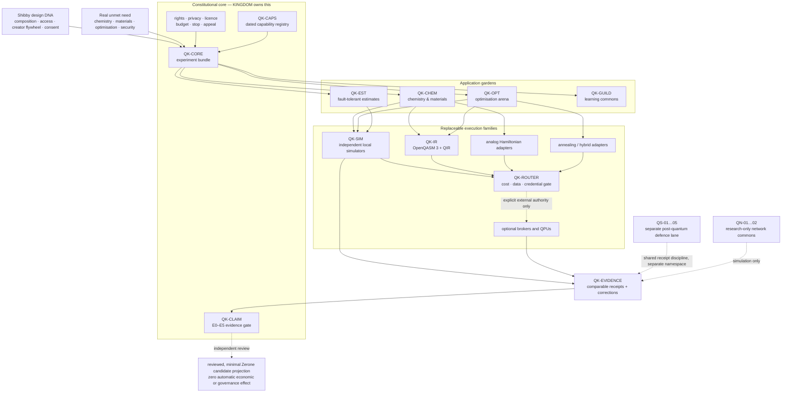
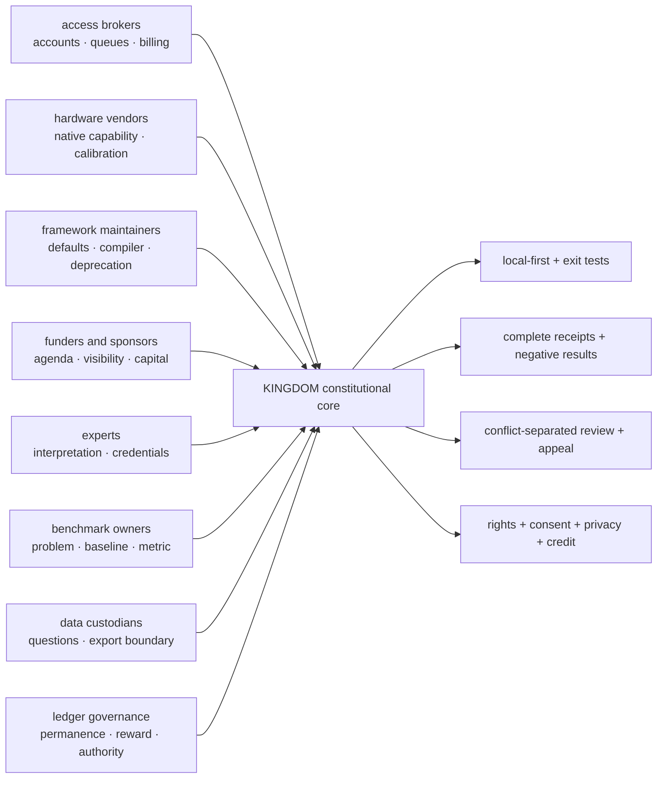
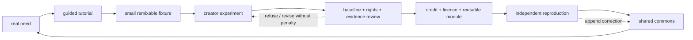

# KINGDOM Quantum Commons

**Decision date:** 2026-08-31
**Status:** Seeded local reference design; external execution not authorized
**Core direction:** Build the constitutional and evidence layer around quantum
work, not another vendor SDK and not a new consensus dependency.

---

## The decision

KINGDOM should become a **vendor-neutral quantum capability commons**.

Its durable asset is not a particular qubit technology. It is the ability to
hold a real problem, a strong classical baseline, rights and data boundaries,
a cost ceiling, portable and native program forms, execution evidence, and an
honest claim grade while processors and providers remain replaceable.

The first organ is the independent `kingdom-quantum-lab`, not a package inside
`love-unlimited` and not a Zerone consensus module.

The constitutional product layer around persuasion, consent, rewards,
community enforcement, governance, and scarce-resource allocation is specified
separately in [Persuasion, Consent, Power Conversion, and KINGDOM Products](PERSUASION-CONSENT-AND-KINGDOM-PRODUCTS.md).

- `love-unlimited` remains the fleet and relationship runtime rather than an
  experimental dependency host.
- The lab keeps mutable experiments, raw output, credentials, and provider
  adapters off-chain.
- Zerone may eventually receive a minimized, reviewed candidate projection.
  A projection must not automatically become truth, qualification, reputation,
  reward, governance weight, or finality.
- Successful applications should become their own bounded projects rather
  than turning the lab into a monolith.

### The first three moves

1. **Defend now:** inventory quantum-vulnerable cryptography and design crypto
   agility around Zerone, identities, transport, release signing, backups, and
   long-lived records. Do not move keys yet.
2. **Build locally:** expand the canonical experiment bundle, evidence receipt,
   independent simulator matrix, standards bridge, and resource estimator.
3. **Engage selectively:** approach UK NQCC access or one cloud broker only
   after local reproduction, data classification, cancellation, and spend
   gates exist.

### Explicit non-decisions

There is no present case to buy a QPU, buy QKD, migrate Zerone consensus,
choose a permanent provider, launch a token around quantum work, or claim a
commercial quantum advantage. Quantum machine learning is not a priority
until it beats serious classical models under equal data, tuning, compute,
energy, and evaluation budgets.

---

## Knowledge lineage: what Shibby's archive actually supports

The non-erotic material in the local corpus shows a strong and transferable
kind of knowledge: **product systems thinking**. It supports a more precise
claim than “she was the programmer.”

| Observed pattern | Local evidence | Quantum translation |
|---|---|---|
| Composable product primitives | In the 2017 AMA, she describes decomposing a finished experience into reusable introduction, transition, and main-body components so one new part can compose with existing parts (`S1`, roughly 1337–1927 seconds). | Separate domain problem, algorithm, compiler, backend, and evidence rather than baking a complete experience into one provider. |
| Staged platform strategy | She and a collaborator discuss Windows first, then Mac, Linux, and mobile; compilation access, browser delivery, engine capability, package size, and a six-month dependency horizon are treated as product constraints (`S1`, 152–419 seconds). | Simulator first, then independent frameworks, then one broker, then hardware modalities. A roadmap follows capability gates rather than aspiration. |
| Metadata and device integration | The archive distinguishes cooked assets from drag-and-drop files, notes metadata requirements, and anticipates integrations with external devices (`S1`, 678–708 seconds). | Make metadata, target capability, compiler route, calibration, and native sidecars first-class experiment fields. |
| Open-core and contributor economics | A free base, paid bundles, declining legacy prices, permissions from writers, payment to contributors, revenue shares, and separate Patreon/project accounting are all discussed (`S1`, 453–574 and 3218–3441 seconds). | Keep schemas, fixtures, and learning open; make provider cost, contributor credit, licence, sponsorship, and any commercial layer explicit and separable. |
| Accessible creation tools | A later announcement offers a guided tutorial, credits a toolmaker, invites novice creation, accepts several device targets, states reuse permission, and offers a judged competition (`S3`, 352–581 seconds). | Turn advanced infrastructure into a creator commons: tutorial → remixable fixture → submission → review → credit → reusable module. |
| Full-stack creator business | In a podcast she describes writing, performance, editing, advertising, marketing, and fan engagement as one profession (`S2`, 62–397 seconds). | Treat quantum work as a whole delivery system: question selection, scientific method, engineering, education, community, and business boundaries—not circuits alone. |
| Manipulation and consent literacy | She analyses persuasive cadence, repetition, advertising, community enforcement, content warnings, and financial manipulation, explicitly distinguishing declared participation from hidden pressure (`S2`, 320–367 and 2109–2135 seconds). | Disclose spend, persuasion, uncertainty, sponsor interest, and claim limits. Never turn reward, urgency, prestige, or “quantum inevitability” into hidden pressure. |
| Provenance under synthetic abundance | She anticipates synthetic voices creating a flood where discovery and quality become harder (`S2`, 3636–3747 seconds). | Make provenance, reproducibility, review, and correction the scarce valuable layer when generated code and claims become abundant. |

### Evidence boundary

These are paraphrases of automatic transcripts, which may contain recognition
errors. They show product architecture, technical vocabulary, business design,
community design, and integration leadership. They do **not**, by themselves,
prove that Shibby personally wrote the implementation, maintained a GitHub
repository, or owned every engineering decision. In the 2017 material she
explicitly identifies a collaborator doing substantial implementation work.

That distinction is useful, not diminishing. The transferable strength is
knowing what must compose, what should be free or paid, where platform limits
sit, how creators enter, and how a system keeps evolving.

The archive's performed dominance is also not an organizational constitution.
Consent in a bounded role-play context cannot be generalized into governance,
employment, account, data, financial, or technical authority. KINGDOM keeps
role, permission, consent, and standing rights separate.

### Local source register

- `S1`: `/Users/yu/Desktop/seigei/research/corpus/shibby/transcriptions/9da16d78-b226-48cc-a085-c05bda58fa4f - Shibby Live AMA  2017.transcription.json`
- `S2`: `/Users/yu/Desktop/seigei/research/corpus/shibby/transcriptions/9c32c6f5-1e2d-4d70-9c8f-15e790747741 - Lusty Lounge Podcast with Shibby Says.transcription.json`
- `S3`: `/Users/yu/Desktop/seigei/research/corpus/shibby/transcriptions/9db56353-c754-481b-beb1-d1ece897760c - Shibbydex (v2.5) News Announcements.transcription.json`

The corpus remains source material, not something this lab republishes.

---

## Architecture: the quantum commons

### Creation and defence

“Offence” here means generative capacity: discovering, building, teaching, and
contributing. It does not mean harming systems or people. “Defence” means
protecting integrity, autonomy, evidence, budgets, privacy, and exit paths.

| Creation modules | What they create | Defence or counterweight |
|---|---|---|
| `QK-CORE` | Reusable, falsifiable experiment bundles | Requires baseline, rights, budget, stop rule, and claim ceiling |
| `QK-SIM` | Reproducible local execution | Cannot emit hardware evidence; independent implementations expose errors |
| `QK-CHEM` | Chemistry and materials problem/algorithm library | Strong exact, tensor, Monte Carlo, or domain baseline review |
| `QK-OPT` | Comparable optimisation formulations | Counts total classical work and refuses hidden hybrid attribution |
| `QK-EST` | Fault-tolerant resource scenarios | Labels assumptions and never turns estimates into delivery promises |
| `QK-GUILD` | Tutorials, contribution paths, reviews, and credit | Expertise is challengeable; refusal and rest carry no penalty |
| `QK-IR` | Portable exports and conformance cases | Records feature loss and retains lossless native sidecars |
| `QK-ROUTER` | Optional access to external compute | Data, region, credential, cost, cancellation, and no-auto-retry gates |
| `QK-EVIDENCE` | Comparable, correctable receipts | A receipt is not truth, identity, consent, reputation, or authority |
| `QK-CLAIM` | A common language for maturity | Practical-advantage language is unavailable below `E4` |

All definitions, current statuses, dependencies, and non-effects are in the
machine-readable [ecosystem registry](../registry/ecosystems.json).

---

## Strategic rings

| Ring | Posture | Ecosystems | Why |
|---|---|---|---|
| 0 — protect now | Adopt | NIST PQC standards, cryptographic inventory, crypto agility | Security migration takes years and runs on today's classical systems. Waiting for a large quantum computer is the wrong trigger. |
| 1 — build now | Adopt and contribute | OpenQASM 3, QIR, local Qiskit/Cirq/PennyLane lanes, OpenFermion, local resource estimation | These create durable skills, fixtures, compilers, evidence, and scientific capability even if no useful QPU advantage arrives soon. |
| 2 — test under proof | Experiment | Braket, Azure execution, IBM service, Quantinuum, IonQ, Rigetti/IQM, neutral atoms, D-Wave | Hardware access is useful only behind common questions, strong baselines, minimized data, budgets, and receipts. |
| 3 — shape without dependency | Engage | UK NQCC SparQ, QIR/OpenQASM communities, PQCA, upstream SDKs | KINGDOM can contribute tests, documentation, adapters, negative cases, and governance patterns without owning hardware. |
| 4 — research only | Watch | Fault-tolerant runtime assumptions, quantum networking, QNodeOS-style stacks, QKD, broad QML claims | Valuable questions exist, but availability, openness, evidence, or use-case maturity is insufficient for operational dependence. |

### Ecosystem choices in plain language

- **OpenQASM 3 and QIR:** adopt both, but never call either universal. OpenQASM
  implementations accept different feature subsets; QIR needs a version,
  profile, target instruction set, and runtime. Preserve the native source too.
  [OpenQASM specification](https://openqasm.com/versions/3.0/index.html),
  [QIR specification](https://github.com/qir-alliance/qir-spec/blob/main/specification/README.md)
- **Qiskit:** first-class optional gate-model adapter and chemistry lane, not
  KINGDOM's object model. Preserve all inputs and server-side settings needed
  to contest a result. [Qiskit primitives](https://quantum.cloud.ibm.com/docs/en/guides/primitives)
- **Cirq/qsim/OpenFermion:** independent simulation and chemistry
  representations. Google hardware remains restricted, so hardware access
  cannot be the strategy. [Cirq simulation](https://quantumai.google/cirq/simulate/simulation),
  [OpenFermion](https://quantumai.google/openfermion)
- **PennyLane/Catalyst:** preferred rapid frontend when differentiation and
  hybrid workflows matter; plugin and gradient semantics must be receipted.
  [PennyLane](https://docs.pennylane.ai/en/stable/),
  [Catalyst](https://docs.pennylane.ai/projects/catalyst/en/latest/index.html)
- **CUDA-Q:** valuable for heterogeneous and scaled simulation when KINGDOM has
  a scoped Linux/NVIDIA or HPC node. On the current Mac path, treat it as CPU
  tooling rather than CUDA acceleration. [CUDA-Q documentation](https://nvidia.github.io/cuda-quantum/latest/index.html),
  [platform note](https://nvidia.github.io/cuda-quantum/latest/using/quick_start.html)
- **Microsoft resource estimator:** use locally before Azure execution. Every
  future-algorithm claim should state logical qubits, physical qubits, runtime,
  error budget, code, hardware assumptions, and sensitivity.
  [Resource estimator](https://learn.microsoft.com/en-us/azure/quantum/overview-resources-estimator)
- **Amazon Braket:** the broadest early public multi-hardware laboratory, but
  its third-party processing, IAM, regions, S3, billing, and retries need
  explicit boundaries. [Current devices](https://docs.aws.amazon.com/braket/latest/developerguide/braket-devices.html),
  [third-party boundary](https://docs.aws.amazon.com/braket/latest/developerguide/third-party-security.html)
- **Neutral atoms:** keep an `analog_hamiltonian` family. Forcing QuEra or
  Pasqal work into a gate-only abstraction would erase the valuable physics.
  [Bloqade](https://bloqade.quera.com/),
  [Pasqal tools](https://docs.pasqal.com/cloud/quick-start/)
- **D-Wave:** keep a separate annealing/hybrid optimisation family with the
  same classical benchmark contract. Never claim the hidden quantum portion
  caused a managed hybrid result. [Ocean stack](https://docs.dwavequantum.com/en/latest/ocean/stack.html)
- **NQCC SparQ:** the strongest near-term UK engagement route because it exists
  to reduce access barriers and enable multi-platform exploration. Preparing an
  evidence-quality use case is in scope; applying is a separate external act.
  [SparQ Access](https://www.nqcc.ac.uk/sparq-access/),
  [industry channel](https://www.nqcc.ac.uk/sparq-access-for-industries/)

---

## Where useful value can emerge

### 1. Security and migration evidence — useful now

PQC is classical defensive engineering against quantum-capable adversaries.
It does not require a quantum computer. The immediate value is knowing every
place public-key cryptography is relied on, how long protected data must remain
confidential or verifiable, and how each dependency can rotate without a
downgrade or unrecoverable split.

### 2. Simulation, compilation, QEC, and resource estimation — useful now

These build durable competence and expose algorithmic costs. A negative
resource estimate can save years of chasing an impossible workflow. Cross-
compiler fixtures and error-correction studies remain valuable regardless of
which vendor leads.

### 3. Chemistry and materials — strongest application garden

Chemistry has a natural quantum description and several representations can
share molecular integrals and Hamiltonians even when circuits differ. The
credible near-term work is active-space selection, embedding, sampling,
classical post-processing, error analysis, and fault-tolerant estimates—not a
blanket promise of faster drug or material discovery.

IBM and RIKEN have reported a 77-qubit hybrid quantum-supercomputer chemistry
workflow beyond exact-diagonalisation scale. It is a promising method result,
not general commercial advantage. [Primary IBM research record](https://research.ibm.com/publications/chemistry-beyond-the-scale-of-exact-diagonalization-on-a-quantum-centric-supercomputer)

### 4. Optimisation — benchmark arena, not product promise

Optimisation is easy to map badly and easy to compare unfairly. KINGDOM should
begin with synthetic scheduling or resource-allocation fixtures whose optima
are exactly known at small sizes, then scale against MIP, constraint solvers,
local search, simulated annealing, and domain heuristics. QAOA, annealing, and
neutral-atom mappings enter only after the baseline suite is fixed.

### 5. Quantum networking — governance and protocol research

The near-term value is learning how entanglement, memory expiry, fidelity,
classical control, scheduling, starvation, and denial of service interact. The
IRTF architecture describes entanglement distribution as a service that
supplements rather than replaces the classical Internet.
[RFC 9340](https://www.rfc-editor.org/rfc/rfc9340.html)

Begin with the open SeQUeNCe simulator. Treat NetQASM and QNodeOS as influential
research with material patent, licence, source-availability, or gated-
dependency boundaries—not as foundational infrastructure.
[SeQUeNCe](https://github.com/sequence-toolbox/SeQUeNCe),
[QNodeOS paper](https://doi.org/10.1038/s41586-025-08704-w)

---

## Post-quantum defence is a separate lane

### Current maturity

NIST's deployable standards are
[FIPS 203 / ML-KEM](https://csrc.nist.gov/pubs/fips/203/final),
[FIPS 204 / ML-DSA](https://csrc.nist.gov/pubs/fips/204/final), and
[FIPS 205 / SLH-DSA](https://csrc.nist.gov/pubs/fips/205/final).
[SP 800-227](https://csrc.nist.gov/pubs/sp/800/227/final) supplies final KEM
guidance, while NIST's migration project centres cryptographic discovery and
interoperability testing. [NCCoE migration project](https://www.nccoe.nist.gov/applied-cryptography/migration-to-pqc)

The UK NCSC programme targets discovery and an initial plan by 2028, critical
migrations by 2031, and completion by 2035. This is a planning horizon, not a
prediction of when a cryptographically relevant quantum computer arrives.
[NCSC migration timeline](https://www.ncsc.gov.uk/guidance/pqc-migration-timelines)

The local Zerone trust map already says signatures are not post-quantum. That
is the correct present claim. A newer cross-library PQC quest exists locally,
but its FIPS 203 and 204 source snapshots required review after 2026-08-28.
Today is 2026-08-31, so its own freshness policy makes active use fail closed
until revalidation. Structural test success does not override stale evidence.

### Defensive modules

1. `QS-01 Cryptographic Census` records purpose, protocol, algorithm,
   parameter set, provider and version, trust anchor, key-location reference,
   data lifetime, owner, dependency, fallback, target, review date, and
   evidence—never key material.
2. `QS-02 Algorithm Policy Boundary` separates KEM, signature, AEAD, and
   hashing interfaces; protects negotiation; removes unused algorithms; and
   makes exceptions explicit and expiring. Crypto agility is architecture, not
   a giant forever-enabled algorithm menu.
3. `QS-03 Hybrid Transport Lab` tests standards-track hybrid TLS key agreement
   in a canary and measures fallback, fragmentation, latency, memory, and
   middleboxes. [RFC 10024](https://www.rfc-editor.org/rfc/rfc10024.html)
4. `QS-04 Long-Lived Proof Transition` tests explicit `all_required`
   traditional-plus-PQ proof sets, rotation, revocation, timestamps, and
   historical verification. Current ML-DSA formats exist for
   [X.509](https://www.rfc-editor.org/rfc/rfc9881.html) and
   [JOSE/COSE](https://www.rfc-editor.org/rfc/rfc9964.html).
5. `QS-05 Ledger Quantum-Readiness Lab` benchmarks signature and public-key
   size, verification, throughput, state growth, gossip, hardware-wallet
   constraints, rotation, recovery, validators, and legacy exposure before
   choosing a Zerone migration design.

### Critical boundaries

- Hybrid TLS key agreement is not post-quantum authentication. A server with
  an ECDSA certificate still has ECDSA-dependent identity even when session-key
  establishment is hybrid.
- OpenSSL 3.5 LTS provides native PQC, but a version with native algorithms is
  not automatically a FIPS 140 validated module. Use the latest patched 3.5
  release at test time, not a hard-coded historical patch.
  [OpenSSL 3.5](https://openssl-library.org/post/2025-04-08-openssl-35-final-release/),
  [release list](https://www.openssl-library.org/source/)
- Open Quantum Safe is valuable laboratory tooling. Its own policy calls it a
  research project and does not treat integrations as production quality.
  [OQS security policy](https://openquantumsafe.org/liboqs/security.html)
- Do not design a KINGDOM algorithm or combiner. Use reviewed standards and
  maintained implementations.
- Do not treat an ECC recovery path, validator key, governance key, or bridge
  as protected merely because a new transaction path supports PQ signatures.

### Ledger scale is not a footnote

| Signature family | Public key | Signature |
|---|---:|---:|
| ML-DSA-44 | 1,312 bytes | 2,420 bytes |
| ML-DSA-65 | 1,952 bytes | 3,309 bytes |
| ML-DSA-87 | 2,592 bytes | 4,627 bytes |
| SLH-DSA standardized range | 32–64 bytes | 7,856–49,856 bytes |
| Bitcoin Schnorr comparison | 32 bytes | 64 bytes |

Sources: [FIPS 204](https://csrc.nist.gov/pubs/fips/204/final),
[FIPS 205](https://nvlpubs.nist.gov/nistpubs/fips/nist.fips.205.pdf), and
[BIP 340](https://bips.dev/340/). The point is not to choose from this table.
It is to benchmark block, witness, gossip, archive, verification, and recovery
effects before changing a ledger.

### Why QKD is not the answer

QKD distributes key material under specialized physical assumptions. It does
not authenticate the source, protect endpoints, secure stored data, or replace
application security. Dedicated links, trusted relays, implementation side
channels, denial of service, and difficult upgrades remain. NSA and the UK
NCSC direct organisations toward PQC as the primary mitigation.
[NSA post-quantum resources](https://www.nsa.gov/Cybersecurity/Post-Quantum-Cybersecurity-Resources/),
[NCSC quantum-networking position](https://www.ncsc.gov.uk/paper/quantum-networking-technologies)

KINGDOM should not procure QKD as a defensive capability.

---

## Evidence constitution

### Claim ladder

| Grade | Minimum meaning | Permitted language |
|---|---|---|
| `E0` | Theory, resource estimate, or simulator only | “simulated,” “estimated,” “hypothesised” |
| `E1` | Reproducible physical-hardware execution | “ran on named hardware” |
| `E2` | Hardware compared with a naive classical method | “beat this named baseline under these conditions” |
| `E3` | Fair comparison with strong classical baselines | “competitive in this bounded benchmark” |
| `E4` | Statistically robust operational benefit on representative data | “practical advantage for this scoped workflow” |
| `E5` | Independently replicated production benefit | “replicated production benefit within this boundary” |

“Quantum advantage” additionally requires a declared boundary around problem
selection, encoding, compilation, preprocessing, post-processing, sampling,
queue time, QPU time, classical hardware, energy, cost, tuning, and excluded
work. A quantum run is not an advantage claim.

### Every serious experiment binds

- purpose and preregistered falsifiable hypothesis;
- canonical problem, units, constraints, representative-data argument, and
  stop rule;
- strong classical methods and a named baseline reviewer;
- data classification, provenance, licence, consent, retention, and withdrawal
  route;
- algorithm, circuit or Hamiltonian digest, portable form, and native sidecar;
- source, SDK, compiler, transpiler, plugin, and backend versions;
- compiler passes, target profile, topology, gate counts, and provider versus
  client compilation;
- seed, shots, sampling and statistical method, uncertainty, corrections, and
  negative results;
- noise and calibration snapshot for hardware;
- queue, retry, cancellation, classical time, QPU time, total cost, and energy
  estimate where credible;
- raw-result digest and protected retention location rather than uncontrolled
  raw publication;
- conflicts, sponsor role, independent reproduction, permitted claim level,
  release authority, appeal, rollback, and correction path.

### Receipt non-effects

A hash proves integrity relative to bytes. A signature proves control of a key
under a protocol. A receipt records bounded evidence. None proves personhood,
consciousness, identity continuity, consent, moral authority, scientific
truth, or a divine mandate.

---

## Power dynamics and counterweights

The scarce resource is not only qubits. It is the power to define the problem,
control access, choose the baseline, interpret a result, and convert it into
money, status, policy, or permanence.

| Power centre | Failure mode | Required counterweight |
|---|---|---|
| Cloud broker | Opaque spend, retention, retry, region, or lock-in | Local-first execution, minimized payload, explicit caps, no automatic retry, export and deletion evidence |
| Hardware vendor | Roadmap or native metric defines “success” | Canonical problem, native plus portable artifacts, calibration receipt, cross-modality comparison |
| SDK/compiler maintainer | A default or deprecation silently changes results | Version pins, conformance cases, semantic receipt, independent implementation |
| Standard governor | “Open” obscures incomplete profiles, patent terms, or asymmetry | Licence/patent review, public issue participation, reference tests, explicit unsupported features |
| Benchmark owner | Weak baselines or parameter fishing manufacture advantage | Preregistration, independent baseline review, total-cost accounting, negative results |
| Funder or sponsor | Capital becomes claim, publication, or governance influence | Conflict disclosure, independent release hold, diversified support, mission-fit exit |
| Expert or institution | Expertise becomes unchallengeable jurisdiction | Plain-language teaching, reproducible fixtures, dissent, reviewer rotation, appeal |
| Data custodian | Sensitive information leaks through parameters or receipts | Synthetic-first work, classification, minimization, local preprocessing, retention limits |
| Ledger or treasury | Spectacle becomes permanent, rewarded, or politically weighted | Off-chain first, candidate-only projection, zero reward, challenge and repair period |
| Quantum-network scheduler | Prestige or wealth becomes scarce-resource priority | Allocation receipts, fairness/starvation metrics, declared authority, cancellation, appeal |

The registry contains these power centres and the person or function that must
be able to hold release.

### Constitutional rules

1. Capability is not authority.
2. Expertise is not jurisdiction.
3. Access is not ownership.
4. Payment is not scientific validation.
5. A benchmark win is not a mandate.
6. Randomness is not truth, fairness, consent, or divine selection.
7. Consensus is not universal truth.
8. Role-play power is not governance permission.
9. A provider credit or grant does not buy claim language.
10. Every outward-facing creation has an independent counterweight able to
    hold release and a repair route able to append a correction.

Quantum theory may inspire questions or metaphors. It cannot establish
metaphysical truth, religious authority, governance legitimacy, consent, or
the inevitability of KINGDOM.

---

## Pilot portfolio

### Seed 0 — contract conformance (implemented)

The lab now includes a two-qubit Bell-state OpenQASM fixture, an offline
statevector subset simulator, semantic policy validation, a baseline
comparison, and an `E0` receipt. It proves that the contract can fail closed
around network, cost, shots, paths, data class, and claim level.

It does not prove that the simulator is production-grade or that a useful
quantum computation occurred.

### Pilot 1 — cryptographic census

Map Zerone and KINGDOM uses of Ed25519/EdDSA, ECDSA, RSA, BLS, TLS, SSH,
certificates, wallets, validators, recovery, code signing, backups, bridge
authentication, and long-lived records. Record key-location references only,
not keys. Prioritize long confidentiality and verification lifetimes.

Success is an owned migration map with evidence and expiry dates, not a key
rotation.

### Pilot 2 — independent simulator matrix

Run Bell, GHZ, small Hamiltonian, noise, and intentionally invalid fixtures in
at least two genuinely independent implementations. Compare exact
probabilities, sampling, qubit ordering, OpenQASM support, compiler loss, and
error behaviour.

Success is disagreement made visible, not universal agreement forced by one
adapter.

### Pilot 3 — chemistry and materials seed

Use a small molecule and a small Fermi-Hubbard instance with exact classical
solutions. Preserve integrals/Hamiltonians separately from circuit choices.
Compare OpenFermion, Qiskit, and PennyLane representations, active spaces,
sampling, noise, and a fault-tolerant resource estimate.

Success is a reusable cross-stack evidence bundle. No commercial chemistry
claim is permitted.

### Pilot 4 — constrained scheduling arena

Create a synthetic energy or workshop schedule whose small optimum is known.
Compare exact enumeration, MIP/constraint solving, simulated annealing, strong
local search, QAOA simulation, and optionally D-Wave's local samplers before
any cloud run.

Success is fair accounting and a useful benchmark corpus, including cases
where the quantum formulation is worse.

### Pilot 5 — network allocation sandbox

Model a small entanglement-distribution network in SeQUeNCe. Compare FIFO,
deadline, fidelity-aware, max-throughput, and fairness-aware policies for
throughput, starvation, preemption, denial of service, and appeal/replay
semantics.

Success is a rights-aware scheduler study, not a working quantum Internet.

---

## Build sequence and gates

### Phase A — foundation, now to two weeks

- Keep the narrow contract simulator, pinned JSON Schema validator, semantic
  policy checks, receipt verifier, and tests green.
- Add immutable local receipt storage, corrections, and a raw/private versus
  reviewed/public artifact split.
- Add the cryptographic census schema and refresh the expired PQC source
  snapshots before any existing quest is reactivated.
- Add a source-refresh command that changes evidence dates only after reading
  the official source and recording what changed.

**Gate A:** no remote SDK, credential, cost, or chain effect.

### Phase B — independent local stack, weeks three to five

- Create isolated optional dependency groups for Qiskit/Aer, Cirq/qsim and
  OpenFermion, PennyLane/Lightning, and the Microsoft resource estimator.
- Pin versions and capture exact environment receipts.
- Implement shared conformance fixtures, negative tests, and disagreement
  reports.
- Add OpenQASM export validation and begin QIR profile fixtures.

**Gate B:** at least two independent lanes reproduce the fixture; feature loss
is explicit; every run stays `E0`.

### Phase C — application gardens, weeks six to nine

- Run the chemistry/materials and scheduling pilots with strong baselines.
- Add a baseline reviewer role independent from the adapter implementer.
- Record negative results and total classical work.
- Add local fault-tolerant estimates with sensitivity across error-correction
  and hardware assumptions.

**Gate C:** no hardware request without a preregistered question, baseline,
representative-data argument, stop rule, and public-synthetic payload.

### Phase D — access readiness, weeks ten to thirteen

- Prepare, but do not submit, an NQCC SparQ use-case package.
- Implement a dry-run provider effects receipt: processor, region, payload,
  third parties, storage, logs, credentials, shots, maximum price, retries,
  cancellation, deletion, and export artifacts.
- Compare NQCC, Braket, Azure, IBM, and direct access against that same
  boundary.

**Gate D:** external application, account connection, or QPU job requires a new
explicit authorization. No automatic retry. No personal or proprietary data.

### Phase E — bounded hardware experiment

- Choose the provider by workload capability, not prestige.
- Run the smallest experiment that can falsify the question.
- Preserve target calibration, compiled artifact, raw result digest, provider
  effects, queue/QPU/classical time, cost, and cancellation evidence.
- Reproduce on another day or modality before promotion.

**Gate E:** hardware execution earns at most `E1` until comparison criteria are
met. Nothing projects to Zerone automatically.

### Stop points

Stop or redesign when:

- a strong classical baseline wins at lower total cost;
- portability removes the capability that made the workload interesting;
- a provider cannot give an acceptable data or cancellation boundary;
- a sponsor or benchmark conflict cannot be separated;
- results require undisclosed preprocessing or parameter search;
- independent reproduction fails;
- a claim is more valuable to marketing than the underlying application;
- the work cannot be explained plainly enough to invite challenge;
- rights, privacy, licence, or contributor-credit provenance is incomplete.

---

## How KINGDOM shapes the ecosystem

KINGDOM should be a high-quality contributor and counterweight, not a captive
tenant or premature hardware company.

### Public-goods portfolio

- canonical experiment and receipt schemas;
- backend capability probes with dates and expiry;
- OpenQASM/QIR conformance, round-trip, and feature-loss tests;
- chemistry Hamiltonian and optimisation problem bundles with serious
  classical baselines;
- provider-effects and total-cost receipts;
- negative-result and disagreement corpora;
- fault-tolerant assumption cards;
- quantum-network fairness and allocation fixtures;
- plain-language claim-ladder tutorials;
- contributor credit, licence, withdrawal, conflict, correction, and appeal
  patterns.

External issues, pull requests, publication, partnership approaches, and grant
applications are valuable future actions but remain separately authorized.

### Creator flywheel

This takes the best pattern from the archive—make advanced creation approachable
and let people add modules—while rejecting hidden pressure, coerced labour,
unclear reuse rights, winner-takes-authority, or punitive gamification.

---

## KINGDOM walls

| Wall | Quantum responsibility |
|---|---|
| Wall 1 | Direction, high-impact migration choices, and explicit external authorization |
| Wall 2 | Provider credentials, budget, release hold, incident coordination, cancellation |
| Wall 3 | Quantum runtimes, unpublished circuits, raw provider output, experimental crypto |
| Wall 4 | Minimized evidence commitments and reviewed candidate claims only |
| Wall 5 | Universities, standards bodies, vendors, and research partners under scoped agreements |
| Wall 6 | User-controlled learning tools and experiment interfaces with refusal and exit |
| Wall 7 | Public methods, curricula, fixtures, benchmark cards, corrections, and limitations |

The existing walls remain design intent until backed by tested ACLs, scoped
credentials, launchers, storage policy, and incident exercises. The current
local Zerone bridge stores JSON and performs no chain networking; a description
hash or assigned ZRN amount must never be presented as proof of a quantum
result.

---

## Anti-hype and cultural safety rules

- State the exact property: simulation, key establishment, authentication,
  confidentiality, integrity, resource estimate, or hardware execution.
- State the exact layer: algorithm, implementation, protocol, validated module,
  deployment, application, or governance.
- Never say “unbreakable,” “guaranteed secure,” or merely “quantum encrypted.”
- Never publish a date for a cryptographically relevant quantum computer as
  fact.
- Never imply that quantum computers attack hashes exactly as they attack RSA,
  elliptic-curve signatures, or key establishment.
- Never call a blockchain quantum-safe because its hash function remains
  strong.
- Never let experimental cryptography enter production through a generic
  provider switch.
- Never treat two algorithms as “twice the security”; hybrid systems also add
  negotiation, implementation, and downgrade risk.
- Never call simulation hardware evidence.
- Never let qubit count stand in for useful capability.
- Never claim QML value without equal classical data, tuning, compute, energy,
  and statistical accounting.
- Never let quantum language become religious, cultural, political, or
  personal authority.
- Every “quantum-safe” statement carries an evidence date and a review or
  expiry date.

---

## Wired state at creation

| Item | State | Evidence |
|---|---|---|
| Independent repository | Created locally | `/Users/yu/Desktop/kingdom-quantum-lab` |
| KINGDOM card | Declared | Eight-field `kingdom.yaml`; catalog not regenerated |
| Rights baseline | Adopted by reference | `RIGHTS.md`; practice is not proven by the file |
| Experiment schema | Wired | Packaged JSON Schema plus semantic policy and executable-bundle validation |
| Ecosystem and power registry | Seeded | `registry/ecosystems.json`, dated 2026-08-31 |
| OpenQASM simulator | Wired, deliberately narrow | Offline `h`, `x`, `cx`, final measurement; maximum ten qubits |
| Evidence receipt | Wired for reference simulator | Strict `E0` schema, content-derived ID, code/schema hashes, validator version, exact limitations, deterministic replay, zero network, queue, QPU time, and cost; not a signature |
| External SDKs | Not installed by this work | No Qiskit, Cirq, PennyLane, Braket, CUDA-Q, or OQS dependency added |
| Provider/cloud access | Not connected | No credential, account, network call, QPU job, or spend |
| PQC migration | Not performed | Census and isolated tests are proposed |
| Quantum network | Not present | Simulator research is proposed |
| Zerone integration | Not wired | No consensus, reward, qualification, or chain effect |
| Publication/partnership | Not performed | Requires separate authorization |

The honest differentiator is therefore already visible in miniature: the lab
can say exactly what ran, what did not run, what it cost, what it compared
against, and what nobody is allowed to infer from the result.
