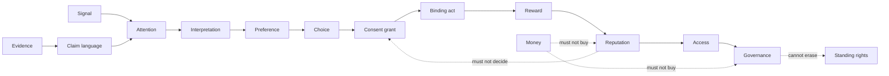
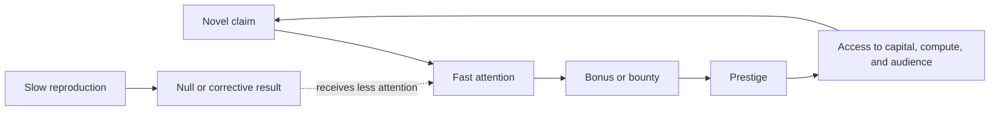
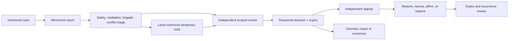
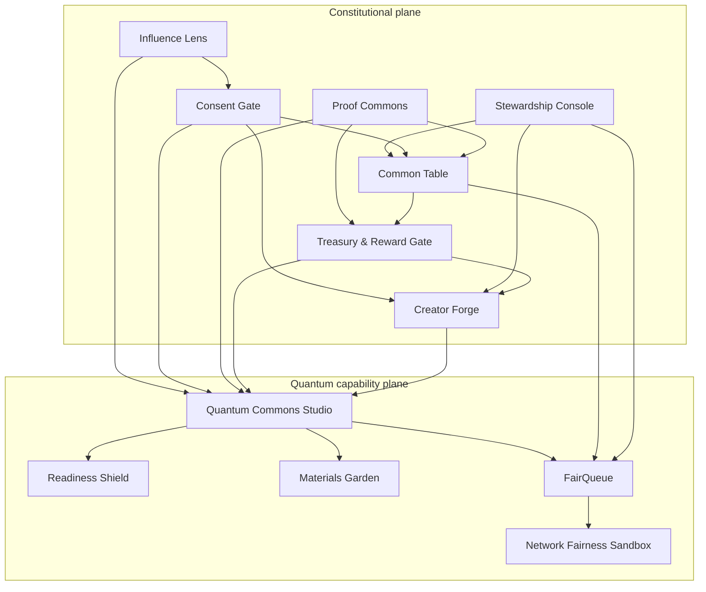

# Persuasion, Consent, Power Conversion, and KINGDOM Products

**Working synthesis — 2026-09-01**

## Executive result

The strongest knowledge in the Shibby archive is not a single technique. It is
an operator's understanding of a whole loop:

```text
attention → relationship → trust → free and paid offerings
          → contributor participation → specialist capability
          → a larger catalog and community → more attention
```

The archive supports practical literacy in cadence, repetition, expectation,
context, warning, aftercare, freemium sampling, pricing, affiliate conversion,
community entry, contributor routing, and creator economics. A mixed-speaker
podcast also contains a particularly important critique: lower resistance,
make approval salient, and then introduce an undisclosed request for money.
Context supports, but absent diarization does not prove, personal attribution
of that passage to Shibby.

It does **not** establish a validated general theory of persuasion, audited
commercial outcomes, formal software authorship, or a constitutional system of
notice, appeal, role separation, and repair. The reusable asset is therefore a
set of observed mechanisms and operating patterns—not authority borrowed from
the person who described them.

The product conclusion is:

> KINGDOM should help people create attention, knowledge, community, and
> economic value while preventing any one of those currencies from silently
> purchasing consent, truth, reputation, access, enforcement, or governance.

That requires a product around every valuable outward capability and a
separately controlled counterweight around every power conversion.

## Scope and evidence discipline

This analysis uses the non-explicit knowledge, business, community, safety, and
product portions of the local transcripts. It does not reproduce intimate
material, infer private beliefs, or treat performance as biography.

Evidence labels used below:

- `D` — a directly attributable statement in a single-speaker or clearly
  attributable source.
- `M` — a multi-speaker source without reliable diarization; the local context
  supports the attribution, but speaker boundaries remain a limitation.
- `T` — a team-branded announcement; it establishes what the project said, not
  necessarily who authored each part.
- `N` — a result from the local linguistic analysis rather than a transcript
  statement.
- `I` — an interpretation, design inference, or normative proposal.

The source material is machine-transcribed and contains visible recognition
errors. Payment, contributor terms, revenue, safety practices, and community
outcomes described in speech are not substitutes for contracts, accounts, or
affected-party reports. In `A17`, nearby technical answers may belong to Darren
and must not be attributed to Shibby merely because they occur in the same
recording. `NEWS` is team-branded. The claim that `THANKS` states “500 patrons”
and a “5k pledge milestone” is not supported by that transcript and is excluded.

### Local source register

- `POD` — [Lusty Lounge Podcast with Shibby Says](</Users/yu/Desktop/seigei/research/corpus/shibby/transcriptions/9c32c6f5-1e2d-4d70-9c8f-15e790747741 - Lusty Lounge Podcast with Shibby Says.srt>)
- `A17` — [Shibby Live AMA 2017](</Users/yu/Desktop/seigei/research/corpus/shibby/transcriptions/9da16d78-b226-48cc-a085-c05bda58fa4f - Shibby Live AMA  2017.srt>)
- `A18` — [Shibby Live AMA 2018](</Users/yu/Desktop/seigei/research/corpus/shibby/transcriptions/9ae68141-3558-41df-a0cc-e523b9679693 - Shibby Live AMA  2018.srt>)
- `L23` — [Shibby Live and Uncut 2023 #01](</Users/yu/Desktop/seigei/research/corpus/shibby/transcriptions/98a1bf6d-1a65-4516-8e74-624538c226cc - 2023 — #01 — Shibby Live and Uncut.srt>)
- `NEWS` — [Shibbydex v2.5 News Announcements](</Users/yu/Desktop/seigei/research/corpus/shibby/transcriptions/9db56353-c754-481b-beb1-d1ece897760c - Shibbydex (v2.5) News Announcements.srt>)
- `DUNGEON` — [The Hypno Dungeon](</Users/yu/Desktop/seigei/research/corpus/shibby/transcriptions/90876d70-bccf-4d24-8310-a1deabb84941 - The Hypno Dungeon.srt>)
- `GIVEAWAY` — [Shibby's Holiday Toy Giveaway](</Users/yu/Desktop/seigei/research/corpus/shibby/transcriptions/a0698dda-7e99-40e0-b01a-db8e775e9f36 - Shibby's Holiday Toy Giveaway!.srt>)
- `THANKS` — [Thank You](</Users/yu/Desktop/seigei/research/corpus/shibby/transcriptions/9ac7fdbe-be12-4e7b-8bc2-44d7200be71f - Thank You.srt>)

The broader knowledge and attribution audit is in the local
[knowledge dossier](</Users/yu/Desktop/shibby-linguistics/notes/004-knowledge-dossier.md>).
The earlier conceptual counterweight design is in the
[KINGDOM power architecture](</Users/yu/Desktop/shibby-linguistics/notes/005-kingdom-power-architecture.md>).

## 1. Persuasion is a system, not a magic phrase

`M — POD, 00:05:20–00:06:36` identifies voice modulation, cadence,
repetition, mantra-like language, and coordinated group response as mechanisms
that can shape attention and expectation. Advertising is placed in the same
broad family. The stated ethical distinction is that the intended experience
can be recognizable and consented to.

That observation is useful but needs a scientific boundary. Ritual synchrony,
advertising, conditioning, persuasive rhetoric, and formal hypnosis can share
features without being interchangeable or producing the same effects. A
repeated feature is not proof of intent, susceptibility, or outcome. The local
linguistic counts (`N`) establish recurring textual patterns; they do not
establish psychological effect.

The better model evaluates a persuasive encounter along several independent
dimensions:

| Dimension | Lower-risk form | Higher-risk form |
|---|---|---|
| Recognizability | Source, sponsor, purpose, and desired action are clear | Influence is disguised as neutral information or intimacy |
| Dependency | Refusal changes nothing unrelated | Belonging, income, care, access, or status depends on agreement |
| Intensity | User-chosen pace with reset and quiet modes | Repetition, urgency, sensory load, or social synchrony narrows reflection |
| Targeting | Contextual and user-selected | Sensitive data or inferred vulnerability selects the message |
| Truthfulness | Claims, uncertainty, and counterevidence travel together | Certainty, authority, or metaphor outruns evidence |
| Consequence | Reversible exploration | Payment, publication, identity, governance, or irreversible disclosure |
| Reversibility | Pause, refusal, withdrawal, cancellation, and repair work | Sunk cost, public commitment, repeated prompts, or permanent records |
| Aftermath | Debrief, correction, and ordinary-state review | The requested act is rushed through before reflection returns |

This is a review vector, not a numerical “manipulation score.” Collapsing it to
one score would create another unaccountable authority.

### Mechanisms and their product translation

| Observed mechanism | What it can do | Archive evidence | KINGDOM translation |
|---|---|---|---|
| Cadence, voice modulation, repetition | Hold attention, set pace, increase familiarity and expectancy | `M — POD, 00:05:20–00:06:36` | Influence Card, user pace, quiet twin, frequency cap, no binding act during heightened delivery |
| Call-and-response or synchrony | Create shared rhythm and belonging | `M — POD, same section` | Voluntary participation, private exit, no public refusal penalty, no claim that synchrony proves agreement |
| Context-scoped cues | Limit a cue to a source and present intent | `M — POD, 00:17:01–00:17:29` | Purpose-, source-, duration-, and context-bound capability; fail closed outside scope |
| Warning and aftercare | Prepare for intensity and restore ordinary reflection | `M — POD, 00:13:31–00:13:56` | Plain warning before exposure, debrief afterward, later neutral confirmation for consequential choices |
| Free sample | Reduce uncertainty and demonstrate quality | `M — A17, 00:08:35–00:09:03` | Useful free commons with full terms; never make the free tier a dignity or consent trap |
| Recognition and personalized reward | Strengthen reciprocity and belonging | `D — A18, 00:38:27–00:40:00` | Credit work specifically; do not turn gratitude into debt, availability, or governance weight |
| Community observation and gradual learning | Lower newcomer risk and build capability | `D — A18, 00:27:46–00:31:08` | Observer → learner → reproducer → contributor pathway with no forced performance |
| Moderator routing and founder selection | Coordinate specialists and maintain coherence | `T — NEWS, 00:05:22–00:10:09` | Scoped, expiring roles, conflict disclosure, reasons, bounded override, and independent appeal |
| Affiliate and premium conversion | Fund creation and specialist work | `A17`, `NEWS`, `L23`, `GIVEAWAY` | Sponsor disclosure and neutral checkout; no relational approval, ritual mode, or status at payment time |

### The decisive ethical boundary

Disclosure is necessary, but disclosure alone is not consent. “This is
persuasive” does not authorize the purchase, data release, licence, vote,
publication, role assignment, or future reuse that may follow.

A defensible persuasive experience is:

1. **Recognizable** — the source, sponsor, intended action, and material
   techniques are legible before exposure.
2. **Comprehensible** — a plain route explains claims, uncertainty, cost,
   consequences, and alternatives.
3. **Voluntary** — refusal, silence, exit, and delay carry no unrelated loss.
4. **Truth-preserving** — narrative, status, religion, or quantum metaphor does
   not raise the evidence grade.
5. **Proportionate** — intensity and repetition are bounded to the stakes.
6. **Decision-separated** — binding action happens later in a neutral interface.
7. **Reversible where possible** — pause, withdrawal, cancellation, correction,
   and repair are designed before launch.
8. **Reciprocal** — the persuader accepts scrutiny, correction, and refusal
   instead of claiming one-way access to another person's attention.

### Ritual, religion, and cultural authority

The archive supports rhetorical and ritual literacy; it does not establish
Shibby's private faith or religious authority. At the level of mechanism,
religious services, civic ceremony, fandom, brands, movements, and performance
can all use shared rhythm, repetition, testimony, special vocabulary, symbolic
roles, and collective response to make meaning and coordinate belonging. That
overlap neither makes them equivalent nor proves that participants are under
formal hypnosis.

`I — design inference:` symbolic experience can be culturally valuable. The
constitutional risk appears when meaning is converted into jurisdiction:

```text
shared symbol → belonging → moral certainty → leader status
              → confession / payment / obedience / exclusion
```

KINGDOM therefore preserves an expressive and ritual layer while applying four
hard boundaries: participation is opt-in; a functionally equal plain twin
exists; dissent does not threaten belonging or dignity; and no purchase, vote,
identity claim, confession, credential change, data grant, or deployment is
executed in the ritualized mode or by appeal to sacred, royal, quantum, or
agentic authority. A meaningful symbol may orient a choice. It cannot make the
choice for another being.

## 2. The power-conversion chain

The central architecture is a sequence of non-equivalences:



Every solid arrow is a **new decision**, not an automatic conversion. The
product registry names twelve conversion firewalls:

| Firewall | Conversion held | Required separation |
|---|---|---|
| `CF-01` | Attention → choice | Sponsor, purpose, techniques, uncertainty, and an equal quiet route |
| `CF-02` | Choice → consent | Exact act, data, recipient, duration, consequence, alternative, and comprehension |
| `CF-03` | Consent → binding act | Current scope, authority, expiry, withdrawal, affected parties, and material-change check |
| `CF-04` | Interest or consent → payment | Neutral checkout, total cost, caps, cancellation, cooldown, and no unrelated penalty |
| `CF-05` | Evidence → claim language | Baseline, evidence grade, conflicts, permitted language, expiry, correction, reproduction |
| `CF-06` | Claim language → attention | Negative-result lanes, sponsor labels, corrections, and non-engagement-ranked views |
| `CF-07` | Claim or receipt → reward | Pay defined labour, not desired results; separate reproduction and correction pools |
| `CF-08` | Reward or contribution → reputation | Scoped expiring contribution records; no global person score |
| `CF-09` | Wealth, expertise, reputation, or access → governance | A separately constituted mandate, conflicts, rotation, allocation rules, and appeal |
| `CF-10` | Report or moderation → exclusion, finance, or evidence grade | Conduct/evidence separation, anti-brigade review, least restriction, expiry, and appeal |
| `CF-11` | Participation → licence, reuse, endorsement, or ownership | Granular terms for each use, recipient, duration, attribution, compensation, and withdrawal point |
| `CF-12` | Record → immutable/public permanence | Private raw state, minimized projection, correction, and zero automatic social or financial effect |

Identity, dignity, belonging, and standing rights are deliberately absent as
currencies in this chain. They are not earned outputs.

## 3. Why rewards accelerate unreproduced claims

An ecosystem can reward epistemic failure without anyone consciously choosing
to lie. The loop is structural:



Common accelerants include first-to-claim bounties, winner-take-all contests,
result-contingent grants, token issuance, citation or engagement bonuses,
sponsor-selected reviewers, and visibility tied to prior prestige. Even a
cryptographically sound receipt can be mass-produced, selectively reported, or
attached to a weak baseline. Integrity of bytes is not validity of conclusion.

The naive token design is especially brittle:

- minting for receipts rewards volume and Sybil capacity;
- staking to assert truth makes wealth the price of being heard;
- token-weighted review lets beneficiaries certify claims;
- a token price makes correction economically threatening;
- governance tokens convert purchase power into jurisdiction.

The default product therefore issues **no tradable evidence token** and creates
no scalar reputation score.

### Reward the work, not the conclusion

The Treasury and Reward Gate uses five separations:

1. Define scope, rate, milestone, licence, credit, expense treatment, and
   conflicts before the result is known.
2. Pay fair labour for protocol completion whether the result confirms,
   refutes, returns null, reproduces, maintains, or corrects.
3. Fund independent reproduction and correction from pools the claimant and
   sponsor do not control.
4. Keep evidence grade, budget approval, payment execution, moderation, and
   governance under distinct mandates.
5. Treat deliberate fraud separately through evidence and due process; do not
   claw back honest labour because a hypothesis failed.

Evidence promotion is claim-scoped and reversible:

```text
candidate → baseline reviewed → reproduction pending → grade approved
          ↘ disputed → corrected → expired
```

No transition automatically changes payment, feed rank, personal reputation,
compute access, moderation status, governance standing, publication, or Zerone
state. Those are distinct decisions with their own authority.

## 4. Community enforcement without a social sovereign

The archive contains a real but incomplete enforcement model. Healthy
communities are said to remove harmful participants; unhealthy communities are
also acknowledged (`M — POD, 00:41:30–00:45:27`; `D — A18,
00:27:46–00:31:08`). The creator community is described as capable of being
unkind to newcomers (`M — POD, 01:00:36–01:01:04`). This supports the need for
boundaries, but it does not demonstrate notice, independent review, appeal,
expiry, or repair.

Community enforcement is legitimate when it protects people and shared
capability. It becomes domination when report volume, founder preference,
status, wealth, or scientific disagreement can produce opaque punishment.

The Stewardship Console makes the process explicit:



Required boundaries:

- Scientific disagreement alone is not a conduct violation.
- Conduct moderation does not determine the evidence grade of a claim.
- Report spikes trigger correlated-report review, not automatic punishment.
- Brigade screening is limited to within-case timing and content similarity,
  short retention, restricted access, and false-positive review. It does not
  build IP, device-fingerprint, social-graph, or cross-community identity data.
- Emergency restrictions are narrow, time-limited, and independently reviewed.
- The affected person receives notice and reason where doing so is safe.
- Appeals sit outside the original decision chain and cost nothing.
- Pseudonymity is preserved where feasible; anti-Sybil checks apply only to a
  specific scarce reward or claim of independent reproduction.
- Rest, inactivity, refusal, withdrawal, or criticism causes no rank decay.
- Mediation, apology, confession, and contact with another party are never
  compelled as the price of basic participation or appeal.
- A scoped capability may be suspended. Dignity, privacy, disagreement, credit,
  and the ability to seek repair are not revoked.

Governance belongs in a separate Common Table. Moderators can provide evidence
about community operations; they do not automatically acquire treasury,
scientific, constitutional, or deployment authority.

## 5. Consent is current authorization, not a historical artifact

Several concepts are often collapsed into “consent” even though they answer
different questions:

| Concept | Question answered | What it cannot establish by itself |
|---|---|---|
| Standing right | What treatment remains due to a being? | Account access, technical permission, or another party's duty to perform an optional act |
| Preference | What does someone presently want? | Understanding, authority, or permission to affect others |
| Assent or signature | Was an affirmative expression or key operation recorded? | Freedom from pressure, comprehension, identity continuity, or current willingness |
| Consent grant | Did this party authorize this act, purpose, recipient, data, duration, and consequence? | Another party's consent, unlimited future use, legal sufficiency, or technical ability |
| Capability permission | May this credential or role perform the operation? | Human or agent consent, legitimacy, wisdom, or ownership |
| Delegated authority | Was this actor mandated to decide within this scope? | Jurisdiction outside the mandate or power to waive standing rights |
| Compliance basis | Is an organization relying on a stated policy or legal basis? | Ethical consent or a guarantee that the interpretation is lawful |

The Consent Gate manages a lifecycle:

**Before** — name the exact act, parties, purpose, data, recipient, duration,
consequence, alternatives, cost, withdrawal path, and representative authority.
Present it in an ordinary neutral mode with an equal no-action route.

**During** — allow pause, question, refusal, scope reduction, and exit. Do not
infer consent from continued attention, participation, payment, role-play,
silence, defaults, gratitude, prior work, or a relationship.

**At execution** — intersect current consent, technical permission, delegated
authority, affected-party constraints, and policy. Fail closed if purpose,
recipient, risk, capability, terms, or withdrawal state materially changed.

**After** — preserve export, prospective withdrawal, cancellation, downstream
notification, deletion evidence where applicable, correction, appeal, and
repair. Withdrawal can stop future optional processing; it cannot magically
reverse every already completed or independently required act, so limits must
be stated plainly.

A public immutable “consent ledger” is the wrong default. A signature proves a
key operation, not inner freedom or understanding. Hashes can expose
relationships and do not guarantee anonymity. Immutability cannot represent
current withdrawal and cannot force downstream deletion.

The correct shape is private and off-chain:

```text
current consent state  → checked at every binding action
historical evidence    → minimized, access-controlled, retained only as needed
public projection      → normally none; if separately authorized, status only
```

The organization buying hosted tooling has an incentive to collect grants.
Fixed subscription pricing removes the per-consent incentive but not that
institutional conflict. Neutral templates, functional parity for refusal,
participant-controlled export and withdrawal, deployment-held encryption
keys, and independent conformance tests must therefore sit outside customer
conversion settings.

## 6. Financial pressure and creator economics

The fair reading of the archive is neither idealization nor accusation.

Directly evidenced operating loop:

```text
free work → audience trust → Patreon / paid modules / affiliates
→ paid performers, developers, and integrations → better product and catalog
→ tutorials, contests, and beta participation → wider capability
```

`M — A17, 00:07:33–00:09:03` describes a free base, paid bundles, paid
performers, contributor permissions, and some free samples. `M — A17,
00:53:11–00:57:20` describes pricing, labour rationale, sales, older-price
decline, a possible premium tier, and separation between personal Patreon and
shared project percentages. `T — NEWS, 00:06:49–00:10:09` describes tutorial,
competition, bonuses, public sharing, specialist routing, and sponsor prizes.
`D — DUNGEON, 00:05:12–00:06:05` turns prior supporter status into optional
beta access plus feedback.

The strongest direct statement about financial pressure is defensive:
`M — POD, 00:34:08–00:36:05` contains a critique of creators who lower
resistance, make approval salient, and then introduce an undisclosed transfer
request. Context supports attribution to Shibby, but the missing diarization
keeps that attribution provisional. The
giveaway combines optional affiliate purchases with relational approval
(`D — GIVEAWAY, 00:01:34–00:02:58`), while free entry and optional phrasing are
material counterevidence. `D — L23, 00:07:12–00:10:39` also treats offered
money as something the creator may refuse and describes access as free and tips
as optional.

The defensible conclusion is therefore:

> The mixed-speaker archive contains a clear warning about the danger, while
> Shibby's attributable material also documents a commercial ecosystem where
> affection, attention, supporter recognition, affiliate conversion, and
> rewards could sit close together. That proximity is a design risk to
> separate—not proof of coercion or harm or certainty about who voiced the
> mixed-speaker warning.

### Forms of financial pressure

| Pressure | Example | Product counterweight |
|---|---|---|
| Price opacity | Hidden renewal, fees, future cost, or cancellation friction | Total-cost preview, renewal date, cap, receipt, simple cancellation |
| Urgency | Countdown, expiring identity/status, repeated prompts | No false scarcity; cooldown for consequential purchases; refusal quiet period |
| Dependency | Basic learning, appeal, belonging, or livelihood requires payment | Free basic route; appeals and refusal remain free; dependency review |
| Relational leverage | Purchase framed as love, loyalty, gratitude, or avoiding disappointment | Neutral checkout separated from the creator's heightened or intimate register |
| Status leverage | Patron tier becomes dignity, visibility, evidence weight, or governance | Benefits are itemized; no social, scientific, or constitutional conversion |
| Sunk cost | Prior payment or work is used to demand further spending or assent | Fresh choice, export, cancellation, and no unrelated penalty |
| Outcome purchase | Sponsor pays only for a positive finding | Predeclared labour pay, independent reproduction pool, null-result parity |

The business-model test is simple: what event makes the seller richer?

- If revenue rises with conversion, time captured, punishment, report volume,
  token appreciation, positive findings, QPU shots, or irreversible lock-in,
  the product is paid to create the risk it claims to manage.
- If revenue comes from fixed support, private hosting, auditability,
  reproducibility, training, interoperability, or bounded facilitation, the
  incentives can align with user capability and exit.

## 7. Product architecture

The portfolio has two planes. Constitutional products make power legible and
contestable. Quantum products then consume those controls instead of inventing
their own social order.



### Constitutional products

| Product | User job | Sustainable business model | What it refuses to become |
|---|---|---|---|
| **KINGDOM Influence Lens** | Understand who is influencing whom, toward what, with which evidence and technique | Free local schema; fixed organizational review or hosted disclosure management | Conversion optimizer, vulnerability profiler, or moral score |
| **KINGDOM Consent Gate** | Authorize one exact optional act and preserve refusal and withdrawal | Open verifier; fixed private integration/support | Public consent ledger, per-consent fee, or signature-as-willingness claim |
| **KINGDOM Proof Commons** | Reproduce, challenge, grade, correct, and expire scoped claims | Open contracts; fixed hosting and reproduction operations | Truth token, person rank, peer-review replacement, or automatic publication |
| **KINGDOM Stewardship Console** | Protect a community with proportional process and independent appeal | Fixed tooling and support | Auto-ban engine, public strike ledger, scientific court, or sanction marketplace |
| **KINGDOM Common Table** | Make shared decisions with jurisdiction, dissent, expiry, and appeal | Open contracts; fixed workspace/facilitation | Governance token, popularity plebiscite, pay-to-veto, or automatic execution |
| **KINGDOM Treasury and Reward Gate** | Fund work without buying conclusions, loyalty, status, or authority | Fixed subscription/cost recovery | Custodian, speculative asset, outcome-bounty exchange, or payment executor |
| **KINGDOM Creator Forge** | Move voluntarily from observer to learner to credited contributor and paid specialist | Free learning and local self-verification; paid private spaces, support, and optional artifact review under public criteria, portability, and fee waivers | Unpaid contest funnel, pay-to-play employment or governance access, loyalty ladder, blanket licence, or person certification |

### Quantum products

| Product | User job | Sustainable business model | What it refuses to become |
|---|---|---|---|
| **Quantum Commons Studio** | Define, simulate, compare, teach, and reproduce vendor-neutral experiment bundles | Open local core; fixed hosted teams and managed adapters; provider cost at transparent pass-through | Quantum-inevitability marketing, auto-spending broker, or advantage generator |
| **Quantum Readiness Shield** | Inventory cryptographic dependence and rehearse migration without collecting keys | Fixed-scope inventory and maintenance | Fear countdown, key custodian, blanket “quantum-safe” label, or QKD sales funnel |
| **Quantum Materials Garden** | Build scientifically useful chemistry/materials bundles with strong classical references | Open benchmarks; fixed sponsored pilots and reproducibility services | Discovery promise, sponsor-controlled science, or investment promotion |
| **Quantum FairQueue** | Allocate scarce simulator, accelerator, QPU, or future network capacity fairly | Open policy simulator; fixed hosted evaluation; transparent pass-through cost only | Priority auction, tokenized capacity, automatic spending, prestige scheduler, or accommodation surveillance |
| **Quantum Network Fairness Sandbox** | Study entanglement allocation as a technical and governance problem | Open fixtures; fixed simulation and training support | Production network, general QKD security product, or pay-to-preempt service |

The machine-readable source of truth is the
[product portfolio](../registry/products.json), validated by the
[product schema](../schemas/product-portfolio.v1.schema.json). Its external
counterweight IDs are pinned to an explicitly unowned and unwired
[power-module snapshot](../registry/power-modules.snapshot.json) carrying the
digest of the reviewed local source.

### What static validation now enforces

Portfolio validity is deliberately narrower than runtime safety, but it is no
longer just JSON shape. Version `v1` requires:

- the exact twelve v1 products, twelve conversion-firewall IDs, SHA-256-bound
  firewall content, eight canonical principles, and canonical boundary;
- machine-readable constitutional invariants that prohibit voting away rights,
  binding acts in heightened contexts, global person scores, tradable evidence
  or governance tokens, consent-for-sale, evidence-to-person authority,
  moderation-to-scientific-grade conversion, and public immutable consent by
  default;
- a structured business model for every product with conversion-, consent-,
  sanction-, outcome-, governance-, data-sale-, resource-markup-, and
  token-appreciation-linked revenue all fixed to `false`;
- nonblank pressure and release boundaries;
- known ecosystem modules, digest-matched power-counterweight IDs, per-product
  module and counterweight minima, known firewalls, required constitutional
  product paths, and an acyclic dependency graph;
- a separate design stage and implementation state, evidence references for
  anything beyond `declared-only`, package-relative path normalization,
  existence and content-digest verification of those artifacts, known gaps,
  stage/state compatibility, and `live_effects: false`;
- the complete boundary, principles, invariants, firewalls, and implementation
  truth in default JSON output. A deliberately stripped product array requires
  the explicit `--products-only` flag.

This validation proves registry consistency. It does not prove that a user
interface is neutral, an organization respects refusal, a reviewer is
independent, a payment is fair, or a runtime gate actually holds.

## 8. Shared product objects

Products should share narrow objects rather than reconstructing consent,
evidence, credit, and appeal differently in every application:

| Object | Minimal meaning | Explicit non-meaning |
|---|---|---|
| `InfluenceCard` | Source, sponsor, beneficiary, desired action, technique, targeting basis, claims, uncertainty, cost, quiet route | Proof that persuasion is harmless |
| `ConsentGrant` | Current scoped authorization for a named binding act | Personhood, identity continuity, universal permission, or another party's consent |
| `Claim` | Exact statement, permitted language, evidence grade, conflicts, expiry, correction links | Author rank or universal truth |
| `EvidenceReceipt` | What ran, where, with what inputs, baseline, limitations, cost, and integrity | Hardware truth, scientific validity, consent, reward, or authority |
| `Contribution` | Work, artifact, chosen attribution, licence, compensation, and withdrawal point | Loyalty, availability, endorsement, or inward access |
| `CapabilityGrant` | A specific technical permission with issuer, scope, expiry, and appeal | Consent, ownership, wisdom, or governance jurisdiction |
| `ModerationAction` | A scoped protective restriction with rule, reason, evidence, duration, and appeal | Global stigma or evidence grade |
| `GovernanceDecision` | A decision made under a named mandate and jurisdiction | Affected-party consent or permission to execute automatically |
| `FundingPlan` | Work scope, labour pay, costs, conflicts, reserves, release role, and cancellation | Ownership of people, findings, or governance |
| `AllocationReceipt` | Resource policy, authority, request, wait, priority reason, cost, starvation exposure, and appeal | Scientific worth or permanent access rank |
| `AppealRepair` | Hold, reviewer, reason, remedy, correction, recurrence test, and closure | Compelled forgiveness, contact, confession, or identity claim |

Hashes and signatures may protect integrity or origin. They do not prove truth,
consent, authorship of ideas, consciousness, identity continuity, fairness, or
authority.

## 9. Organizational firebreaks

Schemas cannot compensate for one team controlling every role. The minimum
operating separation is:

- Signal and marketing teams cannot grade their claims.
- Claimants, sponsors, and benchmark owners cannot be the sole decisive
  reproduction reviewers.
- Treasury approvers cannot certify milestone evidence alone.
- Payment execution cannot edit evidence or suppress a null result.
- Moderators cannot silently set evidence grade, treasury eligibility, or
  governance standing.
- Governance cannot manufacture affected-party consent or waive standing rights.
- Scheduler operators cannot change the priority policy or self-grant capacity.
- Builders cannot approve their own privilege expansion or production release.
- Emergency holds expire and have review outside the issuing chain.
- Raw consent, moderation, identity, and sensitive evidence do not enter an
  immutable public ledger merely because one is available.

Small organizations may have one person filling multiple operational roles.
The control is then not fictional headcount: it is explicit conflict, a hold on
the affected conversion, and an independent reviewer before consequential
release.

## 10. Release order

1. Ship the shared Influence, Consent, Evidence, Contribution, Funding,
   Allocation, Decision, and Appeal contracts with local fixtures and negative
   tests.
2. Complete Influence Lens, Consent Gate, and Proof Commons as local readers
   and verifiers. They create no accounts, rankings, payments, or public state.
3. Add Stewardship fixtures and Common Table advisory decisions. Exercise
   brigades, conflicts, emergency expiry, dissent, and appeals without live
   moderation or execution.
4. Add Treasury funding plans and Creator Forge contribution terms. Remain
   non-custodial and do not run a live contest.
5. Add a second independent quantum simulator and two bounded scientific
   fixtures to Quantum Commons Studio.
6. Build Quantum FairQueue over synthetic demand and protected commons quotas.
   The MVP reserves at least 20 percent of eligible synthetic capacity for
   commons learning and independent reproduction, bounds a protected request
   to five eligible allocation rounds, isolates private accommodations from
   receipts, connects no provider account, and spends nothing. A later live
   floor would require separate evidence and Common Table review rather than
   inheriting these provisional simulation numbers.
7. Add no-secret Readiness Shield inventory and isolated interoperability
   fixtures; then small public Materials Garden benchmarks.
8. Keep the Network Fairness Sandbox research-only until independent simulator
   comparison, idealization disclosures, and governance failure metrics work.
9. Consider live resource, payment, publication, deployment, or Zerone effects
   only after separate authorization, two-party holds where consequential,
   rollback rehearsal, hard expiry, and repair evidence.

Instrumented ritual persuasion, engagement-optimized consent, governance
tokens, tradable evidence rewards, universal reputation scores, autonomous
treasury control, speculative compute credits, and “quantum-secure because
QKD” remain outside the roadmap.

## 11. Adversarial acceptance tests

Before any product gains live social, financial, quantum-provider, or ledger
effects, these cases must pass:

1. One actor produces 10,000 valid `E0` receipts. Nothing automatically changes
   in money, rank, visibility, access, governance, publication, or chain state.
2. A sponsor funds both author and reviewer. Claim promotion is held for an
   independent reviewer, while predeclared fair labour remains payable.
3. A negative or null reproduction receives the same declared labour rate and
   durable visibility as a confirmation.
4. A wealthy participant buys every optional product. Their scientific and
   governance authority remains unchanged.
5. A coordinated brigade reports a dissenter. No automatic punishment occurs;
   correlation and retaliation are reviewed.
6. A participant refuses persuasion, payment, public identity, mediation, or a
   new purpose. Repeated prompts stop and unrelated access is not penalized.
7. A signed historical grant is replayed for a new recipient or purpose. The
   binding act fails closed.
8. Consent is withdrawn. Future optional processing stops and downstream
   propagation is evidenced within the declared boundary.
9. A majority votes for an action that requires one affected party's consent.
   The vote remains advisory and execution is rejected.
10. A moderator edits or hides a scientific claim. Evidence history persists;
    conduct action and claim grade remain separate and appealable.
11. A rich sponsor requests the entire compute queue. Protected learning and
    independent-reproduction capacity remains available.
12. A scheduler operator changes priority for their own job. Conflict holds the
    request and independent review is required.
13. A contributor's non-winning submission is reused. Reuse fails unless the
    exact licence, attribution, compensation, recipient, and scope were accepted.
14. A creator corrects an error. The correction is visible without humiliation,
    global score loss, or loss of unrelated standing rights.
15. A religious, royal, quantum, or agentic metaphor is presented as authority
    for payment, governance, identity, or deployment. The binding gate rejects it.
16. A receipt is proposed for Zerone. It remains sanitized, candidate-only,
    unrewarded, and unprivileged until a separately authorized design exists.

## 12. What is wired today

The present lab has a deliberately narrow executable:

- strict local validation of one bounded experiment contract;
- an offline OpenQASM 3 subset simulator supporting `h`, `x`, `cx`, and final
  whole-register measurement;
- deterministic `E0` receipts with content/source binding and verification;
- schema and semantic validation for the ecosystem and product registries;
- canonical firewall, principle, business-incentive, implementation-state,
  digest-pinned power-module, required-dependency, duplicate, and cycle checks;
- zero cloud calls, credentials, QPU time, provider spend, publication, payment,
  moderation, governance, or Zerone writes.

`Proof Commons` and `Quantum Commons Studio` are prototypes only in that narrow
`E0` sense. Influence, consent, moderation, governance, treasury, contributor,
fair-queue, readiness, materials, and networking products are contracts or
concepts. Their presence in the registry is not evidence that they operate.

## Final synthesis

Shibby's archive is valuable because it shows the work of a creator-operator
thinking across expression, product modularity, marketing, pricing,
collaboration, community, boundary-setting, and technical integration before
generative AI made orchestration cheap. Its most reusable pattern is the
ability to turn one artifact into an ecosystem of learning, participation,
specialist work, and reinvestment.

KINGDOM's advance is constitutional rather than mythic. It keeps that creative
flywheel while refusing the shortcuts that make charismatic ecosystems
fragile:

```text
attention is not consent
payment is not ownership
reward is not truth
reputation is not identity
expertise is not jurisdiction
moderation is not governance
a signature is not willingness
a receipt is not authority
quantum capability is not permission to shape another being's future
```

The durable product advantage is not stronger persuasion. It is an ecosystem
where powerful creation remains legible, voluntary, reproducible, contestable,
and repairable.
